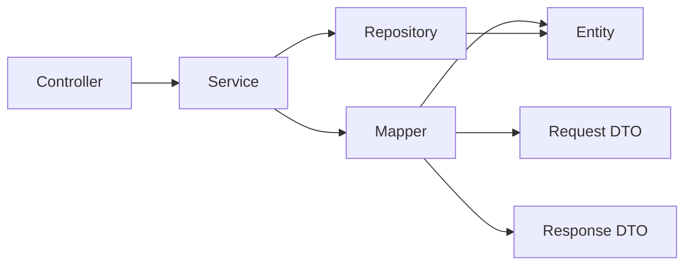

# Requirements

### Current Implementation
Each domain follows the same pattern:
- **Entity** extends `BaseEntity` (UUID `id`, `createdAt`, `updatedAt` via JPA auditing)
- **Request DTO** is a Java record with validation annotations
- **Response DTO** is a Java record with a static `from(Entity)` method that manually maps every field
- **Service** creates entities with manual setters (`entity.setField(request.field())`) and converts to responses via `Response.from(entity)`

Example from `WorkoutService.java`:
```java
Workout workout = new Workout();
workout.setType(request.type());
workout.setName(request.name());
// ... 5 more setters
return WorkoutResponse.from(workoutRepository.save(workout));
```

### Key Decisions
1. **`componentModel = "spring"`** — mappers will be Spring beans, injectable via `@Autowired`
2. **`unmappedTargetPolicy = ReportingPolicy.IGNORE`** — Response DTOs include audit fields that mappers handle automatically; ignore policy prevents warnings for fields not explicitly mapped
3. **Interface-based mappers** — no custom logic needed, so interfaces (not abstract classes) are sufficient
4. **Ignore audit fields on Request → Entity** — `id`, `createdAt`, `updatedAt` are managed by JPA and should not come from DTOs
5. **Lombok-MapStruct binding** — required because entities use Lombok `@Getter`/`@Setter`; processor order: Lombok → MapStruct → Binding

### Proposed Changes

#### 1. pom.xml
- Add `mapstruct` dependency (version 1.6.2)
- Add `mapstruct-processor` and `lombok-mapstruct-binding` to annotation processor paths
- Keep existing `lombok` and `spring-boot-configuration-processor`

#### 2. Mapper Interfaces (4 new files)
Each mapper will provide:
- `Response toResponse(Entity entity)` — entity to response
- `List<Response> toResponseList(List<Entity> entities)` — batch conversion
- `Entity toEntity(Request request)` — request to entity, ignoring `id`, `createdAt`, `updatedAt`

#### 3. Service Refactoring (4 files)
Replace manual setter blocks with mapper calls:
```java
// Before
Workout workout = new Workout();
workout.setType(request.type());
// ...
// After
Workout workout = workoutMapper.toEntity(request);
```
Replace `.map(Response::from)` with `.map(mapper::toResponse)` or use `toResponseList()`.

#### 4. Response DTOs (4 files)
Remove the static `from()` method — no longer needed.

### Architecture Diagram


### Risks
- **Annotation processor order**: If Lombok isn't processed before MapStruct, generated mappers won't see Lombok-generated getters/setters. Mitigated by correct `annotationProcessorPaths` order.
- **Duration type mapping**: `Workout` and `ScreenTimeEntry` use `java.time.Duration`. MapStruct handles this natively, but worth verifying.
- **Boolean field in `HabitEntry`**: The `completed` field uses `isCompleted()` getter (Lombok convention). MapStruct handles this correctly.

### ✓ Step 1: Configure MapStruct in pom.xml
Add MapStruct dependencies and annotation processor configuration.

### ✓ Step 2: Create mapper interfaces for all 4 domains
Create WorkoutMapper, HabitEntryMapper, ScreenTimeMapper, and GitHubActivityMapper.

### ✓ Step 3: Refactor all 4 services to use mappers
Replace manual setter blocks and Response.from() calls with mapper calls.

### ✓ Step 4: Clean up Response DTOs and verify build
Remove static from() methods from Response DTOs and verify build.